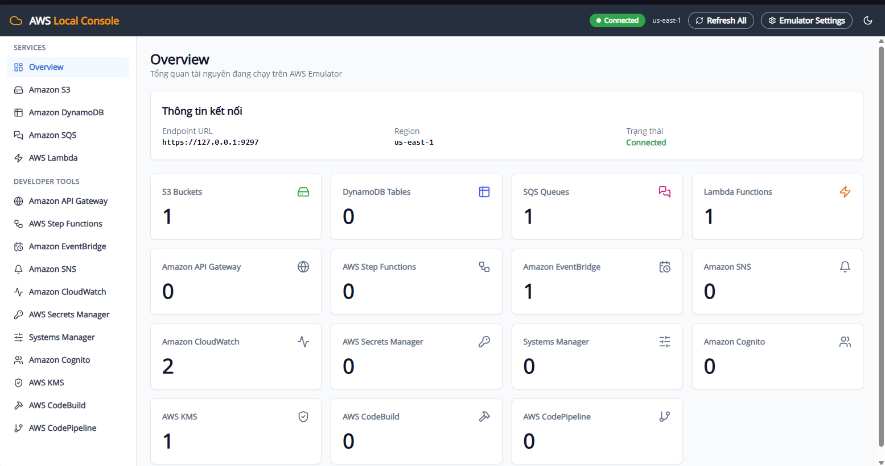

# AWS Local Console

Giao diện web (mini AWS Management Console) để quản lý tài nguyên trên **AWS Emulator** chạy local: S3, DynamoDB, SQS, Lambda, API Gateway, Step Functions, EventBridge, SNS, CloudWatch, Secrets Manager, SSM, Cognito, KMS, CodeBuild, CodePipeline.



```
Browser (Vite :5173) ──/api──▶ Express proxy (:3001) ──AWS SDK v3──▶ AWS Emulator (Docker, https://127.0.0.1:9297)
```

---

## 1. Yêu cầu

- [Docker](https://www.docker.com/products/docker-desktop/) đang chạy
- Image `aws-emulator:latest` đã có trên máy (kiểm tra bằng `docker images aws-emulator`)
- [Node.js](https://nodejs.org/) >= 18 và npm

---

## 2. Setup AWS Emulator

Emulator chạy trong Docker, lắng nghe cổng **9297** (HTTPS, chứng chỉ self-signed) và có **request authentication**: nó tự sinh credential + CA vào thư mục `~/.aws/emulator/<port>/`. Vì vậy cần **mount thư mục này** từ máy host vào container để Console đọc được credential.

### 2.1. Chạy container

**PowerShell (Windows):**

```powershell
docker run -d --name aws-emulator `
  -p 127.0.0.1:9297:9297 `
  -v "$env:USERPROFILE\.aws\emulator:/home/emulator/.aws/emulator" `
  aws-emulator:latest -p 9297
```

**Git Bash / Linux / macOS:**

```bash
docker run -d --name aws-emulator \
  -p 127.0.0.1:9297:9297 \
  -v "$HOME/.aws/emulator:/home/emulator/.aws/emulator" \
  aws-emulator:latest -p 9297
```

Giải thích:

| Thành phần | Ý nghĩa |
| --- | --- |
| `-p 127.0.0.1:9297:9297` | Chỉ mở emulator cho máy local |
| `-v ...\.aws\emulator:/home/emulator/.aws/emulator` | Chia sẻ credential, `ca.pem`, `truststore.p12` giữa container và host |
| `-p 9297` (sau tên image) | Cổng emulator lắng nghe trong container (entrypoint là `aws-emulator -b 0.0.0.0`) |

### 2.2. Kiểm tra emulator đã chạy

```bash
docker ps --filter name=aws-emulator
ls ~/.aws/emulator/9297
```

Thư mục `~/.aws/emulator/9297` phải có các file: `emulator_credentials`, `ca.pem`, `config`, `truststore.p12`.

### 2.3. Quản lý container

```bash
docker stop aws-emulator      # dừng
docker start aws-emulator     # chạy lại (credential có thể được sinh mới, Console tự cập nhật)
docker logs -f aws-emulator   # xem log
docker rm -f aws-emulator     # xoá container
```

### 2.4. Dùng thử bằng AWS CLI (tuỳ chọn)

File `~/.aws/emulator/9297/config` đã có sẵn endpoint, region và CA bundle:

```bash
AWS_CONFIG_FILE=~/.aws/emulator/9297/config aws s3 ls
```

> Lưu ý: `ca_bundle` trong file này trỏ tới `/home/emulator/...` (đường dẫn trong container). Khi chạy CLI từ host, hãy thêm `--no-verify-ssl` hoặc đặt `AWS_CA_BUNDLE` trỏ tới `~/.aws/emulator/9297/ca.pem`.

---

## 3. Chạy source

### 3.1. Cài dependency

```bash
npm run install:all
```

Lệnh này cài cho thư mục root, `server/` và `client/`.

### 3.2. Cấu hình (tuỳ chọn)

Mặc định không cần cấu hình gì: server dùng endpoint `https://127.0.0.1:9297`, region `us-east-1` và tự đọc credential từ `~/.aws/emulator/9297/emulator_credentials`.

Nếu cần thay đổi, tạo file `server/.env`:

```env
PORT=3001
AWS_ENDPOINT_URL=https://127.0.0.1:9297
AWS_REGION=us-east-1

# Chỉ dùng khi KHÔNG đọc được file credential của emulator
AWS_ACCESS_KEY_ID=test
AWS_SECRET_ACCESS_KEY=test

# Ghi đè đường dẫn file credential
# EMULATOR_CREDENTIALS_FILE=C:\Users\<you>\.aws\emulator\9297\emulator_credentials
```

Endpoint và region cũng có thể đổi trực tiếp trên giao diện (nút **Emulator Settings**), không cần restart.

### 3.3. Chạy dev

```bash
npm run dev
```

Lệnh này chạy đồng thời:

- **server** — API proxy tại http://127.0.0.1:3001
- **client** — giao diện tại http://localhost:5173

Mở http://localhost:5173. Trang **Overview** sẽ hiển thị số lượng tài nguyên nếu kết nối emulator thành công.

Chạy riêng từng phần:

```bash
npm --prefix server run dev     # chỉ server (tsx watch)
npm --prefix client run dev     # chỉ client (vite)
```

### 3.4. Build

```bash
npm run build                    # type-check + build client vào client/dist
npm --prefix client run preview  # xem thử bản build
```

---

## 4. Xử lý sự cố

| Triệu chứng | Cách xử lý |
| --- | --- |
| "Không kết nối được tới AWS Emulator" | Kiểm tra `docker ps` container đang chạy, cổng 9297 chưa bị chiếm, và endpoint trong Emulator Settings đúng |
| Lỗi 403 / xác thực | Kiểm tra `~/.aws/emulator/9297/emulator_credentials` có tồn tại (đã mount volume chưa). Nếu emulator mới restart, thử lại sau vài giây; hoặc đặt `AWS_ACCESS_KEY_ID`/`AWS_SECRET_ACCESS_KEY` trong `server/.env` |
| Cổng 9297 đã được dùng | Dừng container cũ: `docker rm -f aws-emulator`, hoặc chạy emulator với cổng khác (`-p 127.0.0.1:9298:9298 ... -p 9298`) rồi đổi endpoint trong Emulator Settings |
| Cổng 3001 / 5173 bị chiếm | Đổi `PORT` trong `server/.env` và cập nhật `target` proxy trong `client/vite.config.ts` |

---

## 5. Cấu trúc thư mục

```
.
├── client/   # React 18 + TypeScript + Vite + Tailwind (pages, components, api.ts)
└── server/   # Express + TypeScript (aws.ts: SDK clients & credentials, routes/: s3, dynamodb, sqs, lambda, infra)
```

Các route API nằm dưới `/api` (`/api/health`, `/api/overview`, `/api/s3`, `/api/dynamodb`, `/api/sqs`, `/api/lambda`, `/api/infra`).
